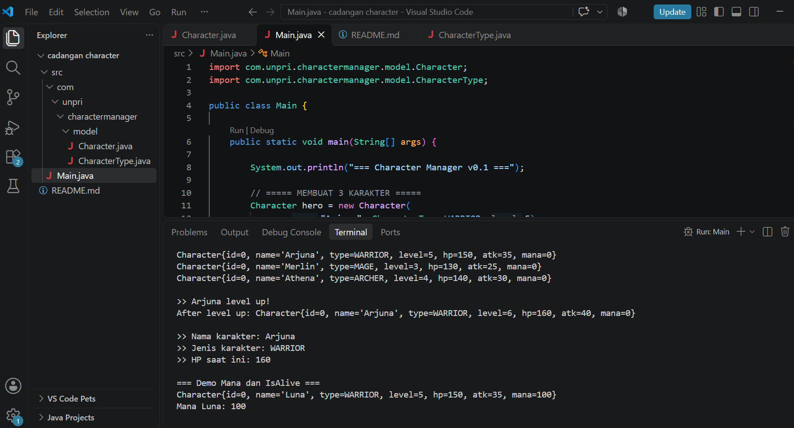
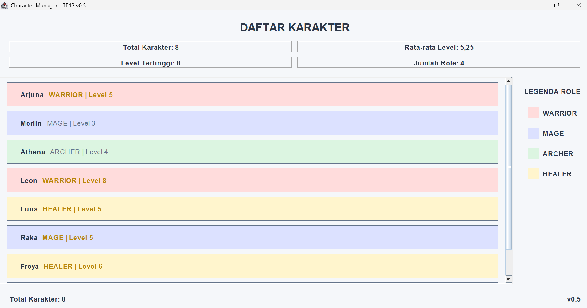
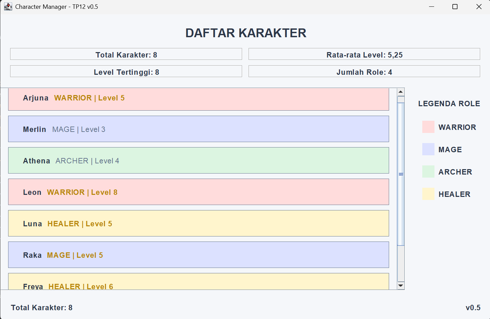
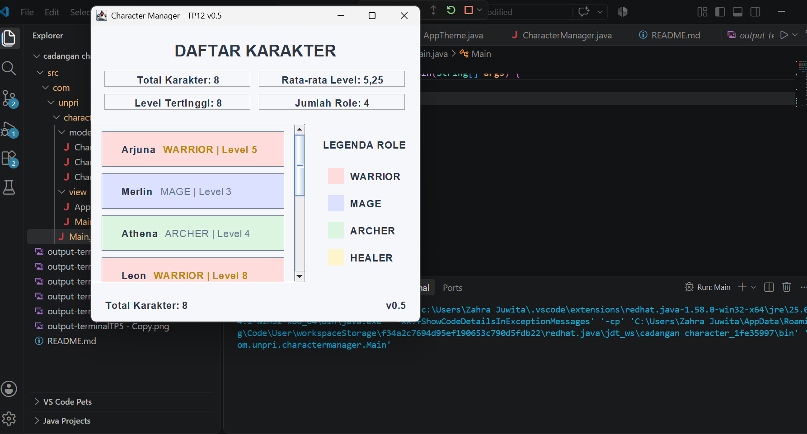

# Character Manager — TP3 (Java Visual SIH-6406)

## Deskripsi Project

Character Manager merupakan program sederhana berbasis Java yang digunakan untuk mengelola data karakter dengan menerapkan konsep Object-Oriented Programming (OOP). Program ini memiliki fitur untuk membuat karakter, menampilkan informasi karakter, menaikkan level, serta mengelola mana dan memeriksa status kehidupan karakter menggunakan method `isAlive()`.

Project ini dibuat sebagai implementasi pembelajaran Java mengenai class, object, constructor, encapsulation, enum, getter, setter, dan method.

## Screenshot Output Terminal

Berikut merupakan hasil pengujian program Character Manager melalui terminal Visual Studio Code.



Output program mencakup:
- Menampilkan 3 karakter: Arjuna, Merlin, dan Athena.
- Melakukan proses level up pada karakter Arjuna.
- Menampilkan perubahan level, HP, dan attack power.
- Membuat karakter baru bernama Luna.
- Mengatur mana Luna menjadi 100.
- Menguji status kehidupan karakter menggunakan method `isAlive()`.

## Struktur Folder Project

```text
cadangan character/
│
├── src/
│   ├── com/
│   │   └── unpri/
│   │       └── charactermanager/
│   │           ├── Main.java
│   │           │
│   │           └── model/
│   │               ├── Character.java
│   │               └── CharacterType.java
│
└── README.md
```

## Identitas Mahasiswa

- **Nama:** Santa Mariani Elisabeth Simangunsong
- **NIM:** [253303621241]
- **Program Studi:** Sistem Informasi
- **Universitas:** Universitas Prima Indonesia

## Link Google Docs — Bagian D

[https://1drv.ms/b/c/251df1b2271152b7/IQBqCa0O3Q1wQbgZeQnYluOWARnYU1lLalO2W2HIiKMZ334?e=MIEOYt]

---

**Mata Kuliah:** Java Visual SIH-6406  
**Tugas:** Character Manager Sprint #1  
**Bahasa Pemrograman:** Java  
**JDK:** 17 atau lebih baru

# Character Manager - TP5 (Java Visual SIH-6406)

## Deskripsi Project
Character Manager menggunakan bahasa Java dengan menerapkan konsep Object-Oriented Programming (OOP), khususnya pengelolaan objek, reference, dan encapsulation. Pada tugas ini, mahasiswa diminta mengembangkan class CharacterManager agar mampu mengelola data karakter melalui fitur CRUD (Create, Read, Update, Delete), menambahkan fitur analitik, serta memahami bagaimana reference bekerja dalam Java.

## Screenshot Output Terminal

Berikut merupakan hasil pengujian program Character Manager melalui terminal Visual Studio Code.


Output program mencakup:
 Menambahkan karakter (Arjuna, Merlin, Athena).
 Menguji perbandingan karakter menggunakan equals().
 Menguji penolakan nama duplikat.
 Menampilkan seluruh data karakter.
 Menguji pencarian dan penghapusan karakter.
 Menghitung total dan rata-rata level.
 Menguji findByType().
 Menguji salinan daftar (getAllCharacters()).
 Menguji fitur analitik countByType().
 Membuktikan konsep reference menggunakan dua variabel objek.

 # Struktur Folder Project

cadangan character/
│
├── src/
│   └── com/
│       └── unpri/
│           └── charactermanager/
│               │
│               ├── Main.java
│               │
│               └── model/
│                   ├── Character.java
│                   ├── CharacterManager.java
│                   └── CharacterType.java
│
├── output-terminalTP3.png
└── README.md

# Fitur Analitik Rancangan Sendiri

Pada project ini, saya mengembangkan fitur analitik tambahan berupa method countByType() pada class CharacterManager.

Method countByType() berfungsi untuk menghitung jumlah karakter berdasarkan jenis atau tipe karakter tertentu, seperti WARRIOR, MAGE, ARCHER, dan HEALER.

Cara Kerja Method

Method ini menerima parameter berupa CharacterType, kemudian melakukan perulangan terhadap daftar karakter untuk memeriksa tipe masing-masing karakter. Apabila tipe karakter sesuai dengan parameter yang diberikan, jumlah penghitung akan bertambah satu.

# Penerapan Encapsulation

Method ini tetap menjaga prinsip encapsulation karena tidak memberikan akses langsung kepada pengguna terhadap ArrayList internal. Pengguna hanya menerima hasil perhitungan berupa nilai integer sehingga data asli tetap terlindungi.

Selain itu, method dilengkapi validasi untuk memastikan parameter tipe karakter tidak bernilai null dan dokumentasi Javadoc untuk menjelaskan fungsi method.

Alasan Pemilihan Method

Saya memilih countByType() karena fitur ini dapat mempermudah proses pengelompokan dan perhitungan jumlah karakter berdasarkan jenisnya. Dengan adanya fitur ini, pengguna tidak perlu menghitung jumlah karakter secara manual.

Fitur ini juga membuat pengelolaan data menjadi lebih praktis, efisien, dan mudah dikembangkan apabila terdapat penambahan jenis karakter baru.

Identitas Mahasiswa

Nama: Santa Mariani Elisabeth Simangunsong
NIM: 253303621241
Program Studi: Sistem Informasi
Fakultas: Sains dan Teknologi
Universitas: Universitas Prima Indonesia

# Link Google Docs - Bagian D

[https://1drv.ms/b/c/251df1b2271152b7/IQDEDFv0eVXHSIcTdV_Gs-VhAZ9Z8qvlclvV6vV4gejI-7g?e=AKL0IF]

Mata Kuliah: Java Visual SIH-6406
Project: Character Manager Sprint #1
Bahasa Pemrograman: Java
JDK: 17

# Character Manager Sprint #3

# Deskripsi Projek
TP8 (Tugas Praktikum 8 — Character Manager Sprint #3) adalah pertemuan penting yang menandai transisi besar dari program berbasis teks (console) ke antarmuka grafis (GUI) menggunakan Java Swing.

## Screenshot Output Terminal
**Kondisi Awal (5 karakter):
![Screenshoot Awal] (output-terminal sebelumTP08)
kondisi setelah perubahan (8 karakter)
![Screenshoot Setelah perubahan] (output-terminal sesudahTP08)

# Aliran Data & Konsep MVC
Aliran data dimulai dari kelas Main (berperan sebagai Controller inisialisasi) yang membuat objek karakter lalu memasukkannya ke dalam CharacterManager (berperan sebagai Model untuk menyimpan daftar karakter dan menghitung statistik rata-rata level). Objek CharacterManager tersebut kemudian diteruskan ke MainWindow (berperan sebagai View berbasis Java Swing) untuk merender daftar karakter beserta nilai rata-ratanya secara dinamis ke antarmuka pengguna. Pemisahan tanggung jawab ini menerapkan pola arsitektur MVC (Model-View-Controller), di mana logika pengelolaan data di dalam Model terisolasi sepenuhnya dari tampilan antarmuka pada View sehingga kode lebih modular dan mudah dipelihara.

#  Daftar Karakter Baru & Alasan Pemilihan Tipe/Level
Nama KarakterTipe (CharacterType)LevelAlasan Pemilihan Tipe & LevelRaka
- MAGE 5 Menyeimbangkan komposisi serangan jarak jauh berbasis sihir dalam tim, dengan Level 5 sebagai level menengah yang kompetitif.
- FreyaHEALER6Memperkuat daya tahan (support) tim karena sebelumnya baru terdapat satu 
- Healer (Luna), dengan Level 6 untuk kapasitas pemulihan lebih tinggi.
- OrionARCHER 6Menambah variasi penyerang fisik jarak jauh mendampingi Athena, dengan Level 6 guna meningkatkan rata-rata kekuatan keseluruhan tim.  
 
# Link Google Docs - Bagian D
[https://1drv.ms/b/c/251df1b2271152b7/IQDbopTQA6o0TomgWWKhvZvJAc8tDxn3JBCgbx3WMEovtIM?e=fhNfYt]

# Character Manager Sprint 4 

Aplikasi Character Manager dibuat menggunakan Java dan Java Swing untuk menampilkan daftar karakter beserta role dan levelnya. Proyek ini menerapkan pemisahan tanggung jawab antara Model dan View.
TP10 — Theming, Properti Komponen, dan Analisis MVC
1. Screenshot sebelum dan sesudah
Sebelum TP10 (v0.3) [output-terminalsebelumv0.3.png]

Sesudah TP10 (v0.4) [output-terminalsesudahv0.4.png]

Pada versi v0.3, daftar karakter ditampilkan dengan tampilan sederhana. Pada versi v0.4, setiap kartu karakter memiliki warna latar sesuai role, sedangkan level 5 atau lebih ditampilkan dengan teks berwarna emas dan tebal. Versi v0.4 juga menggunakan pack() agar ukuran jendela menyesuaikan komponen yang ditampilkan.
2. Alasan warna disimpan di AppTheme
Warna merupakan bagian dari tampilan antarmuka sehingga pengaturannya diletakkan di AppTheme pada package view. Class Character termasuk Model dan sebaiknya hanya menyimpan data karakter, seperti nama, tipe, dan level, bukan informasi visual. Dengan pemisahan ini, tema aplikasi dapat diubah tanpa mengubah struktur atau logika data karakter. Selain itu, Model tidak perlu bergantung pada class tampilan seperti Color dari AWT atau komponen Swing.
3. Dua properti tambahan dan alasannya
4. Tooltip pada kartu karakter — kartu menampilkan informasi nama, role, dan level ketika pointer diarahkan ke kartu. Properti ini memudahkan pengguna melihat detail karakter tanpa menambah banyak teks pada tampilan utama.
5. setEnabled(false) untuk karakter level 1 — kartu dan label karakter dengan level 1 dibuat tidak aktif. Ini menjadi penanda visual bahwa karakter tersebut belum dapat digunakan, sekaligus menunjukkan penggunaan properti komponen Swing berdasarkan nilai level karakter.
6. Link Google Docs — Bagian D
Link Google Docs: [https://1drv.ms/b/c/251df1b2271152b7/IQBoXvXcTlMYRKOfSt3kbU5ZAW36omJbhIbst6hcX-5EPMg?e=lPLy1B] 

# Character Manager Sprint #5
## Layout, UI Responsif & Analisis MVC

---

## 1. Deskripsi Proyek

Character Manager Sprint #5 merupakan pengembangan lanjutan dari proyek Character Manager Sprint #4. Pada tahap ini, aplikasi dikembangkan dengan fokus pada penggunaan Layout Manager, tampilan antarmuka yang responsif, serta penerapan konsep Model-View-Controller (MVC).

Pengembangan ini bertujuan agar tampilan aplikasi tetap terstruktur ketika ukuran jendela diperbesar maupun diperkecil. Selain itu, aplikasi menggunakan beberapa jenis Layout Manager sesuai kebutuhan setiap komponen, seperti BorderLayout, GridLayout, dan BoxLayout.

## 2. Tujuan Pengembangan

Tujuan pengerjaan Character Manager Sprint #5 adalah:

- Mengimplementasikan BorderLayout dengan empat wilayah utama.
- Membuat daftar karakter menggunakan JScrollPane.
- Menggunakan BoxLayout untuk menyusun legenda karakter.
- Menambahkan panel statistik dengan GridLayout 2×2.
- Membuat tampilan aplikasi yang responsif terhadap perubahan ukuran jendela.
- Mempertahankan pemisahan Model dan View dalam konsep MVC.
- Memahami fungsi preferred size, revalidate(), dan repaint().

## 3. Struktur Tampilan Aplikasi

Aplikasi Character Manager v0.5 menggunakan BorderLayout sebagai layout utama dengan empat wilayah yang memiliki fungsi berbeda.

| Wilayah | Komponen | Fungsi |
|---|---|---|
| NORTH | Header dan statistik | Menampilkan judul serta informasi statistik karakter |
| CENTER | Daftar karakter | Menampilkan kartu karakter menggunakan JScrollPane |
| EAST | Legenda | Menampilkan jenis karakter berdasarkan CharacterType |
| SOUTH | Status Bar | Menampilkan informasi aplikasi dan versi v0.5 |

## 4. Wireframe Aplikasi

Berikut merupakan rancangan tata letak aplikasi Character Manager Sprint #5.

```text
+--------------------------------------------------+
|                  HEADER (NORTH)                  |
|               CHARACTER MANAGER                 |
|--------------------------------------------------|
|              PANEL STATISTIK 2x2                |
|       Total       |       Rata-rata Level       |
|       Warrior     |       Mage                  |
+--------------------------------------+-----------+
|                                      |           |
|          DAFTAR KARAKTER             |  LEGENDA  |
|             (CENTER)                 |  (EAST)   |
|                                      |           |
|    +---------------+                 |  Warrior  |
|    |   Character 1 |                 |  Mage     |
|    +---------------+                 |  Archer   |
|    +---------------+                 |  Healer   |
|    |   Character 2 |                 |           |
|    +---------------+                 |           |
|                                      |           |
|              JScrollPane             |           |
+--------------------------------------+-----------+
|                  STATUS BAR                      |
|  Character Manager - Ready                  v0.5 |
+--------------------------------------------------+
```

## 5. Implementasi Layout Manager

### A. BorderLayout

BorderLayout digunakan sebagai layout utama pada MainWindow. Layout ini membagi tampilan menjadi lima wilayah, yaitu NORTH, SOUTH, EAST, WEST, dan CENTER.

Dalam proyek ini, empat wilayah digunakan untuk menempatkan header, daftar karakter, legenda, dan status bar. Penggunaan BorderLayout membuat susunan antarmuka lebih terorganisasi dan memudahkan pengaturan komponen.

### B. GridLayout

GridLayout digunakan untuk menyusun kartu karakter dalam bentuk dua kolom. Setiap kartu mendapatkan ukuran sel yang seragam sehingga informasi karakter dapat ditampilkan dengan rapi.

GridLayout juga digunakan pada panel statistik dengan susunan 2×2 untuk menampilkan empat informasi, yaitu total karakter, rata-rata level, jumlah Warrior, dan jumlah Mage.

### C. BoxLayout

BoxLayout digunakan pada panel legenda dengan orientasi Y_AXIS. Dengan demikian, setiap jenis karakter ditampilkan secara vertikal.

Penggunaan Box.createVerticalStrut() memberikan jarak antarlabel, sedangkan Box.createVerticalGlue() membantu mengatur ruang kosong pada panel legenda.

### D. JScrollPane

JScrollPane digunakan untuk membungkus panel daftar karakter. Ketika jumlah karakter melebihi area yang tersedia, pengguna dapat menggunakan scrollbar untuk melihat seluruh daftar karakter.

Panel kartu dimasukkan ke dalam JScrollPane sebagai view, bukan menambahkan kartu langsung ke scroll pane.

## 6. Panel Tambahan dan Alasan Pemilihan Layout

Pada pengembangan Sprint #5, ditambahkan panel statistik menggunakan GridLayout 2×2.

Panel ini dipilih karena dapat menampilkan empat informasi penting secara terstruktur dengan pembagian baris dan kolom yang sama. Informasi statistik menjadi lebih mudah dibaca karena setiap komponen memiliki ruang yang seragam.

Layout yang tidak dipilih adalah FlowLayout untuk panel statistik. FlowLayout lebih sesuai untuk menyusun komponen secara berurutan dari kiri ke kanan, sedangkan panel statistik membutuhkan susunan yang konsisten dalam empat bagian. Oleh karena itu, GridLayout dianggap lebih sesuai dengan kebutuhan tampilan statistik aplikasi.

## 7. Struktur Panel Bersarang

Aplikasi menggunakan beberapa panel bersarang untuk memisahkan fungsi setiap bagian antarmuka. JPanel utama menggunakan BorderLayout untuk mengatur header, daftar karakter, legenda, dan status bar. Pada bagian header terdapat panel statistik dengan GridLayout 2×2, sedangkan daftar karakter menggunakan JPanel dengan GridLayout yang dibungkus oleh JScrollPane. Panel legenda menggunakan BoxLayout Y_AXIS agar setiap jenis karakter tersusun secara vertikal. Struktur ini membuat setiap komponen memiliki tanggung jawab tampilan yang lebih jelas dan mudah dikelola.

## 8. Pengujian Responsivitas Aplikasi

Pengujian dilakukan dengan mengubah ukuran jendela aplikasi untuk mengetahui apakah tata letak tetap berfungsi dengan baik.

### Screenshot 1 – Ukuran Awal



Keterangan: Tampilan aplikasi ketika pertama kali dijalankan dengan ukuran jendela normal.

### Screenshot 2 – Jendela Diperlebar



Keterangan: Tampilan aplikasi ketika ukuran jendela diperbesar. Area daftar karakter menyesuaikan ruang yang tersedia.

### Screenshot 3 – Jendela Diperkecil



Keterangan: Tampilan aplikasi ketika ukuran jendela diperkecil hingga scrollbar pada daftar karakter terlihat.

### Tabel Pengamatan Resize

| Kondisi | Prediksi | Hasil Pengamatan |
|---|---|---|
| Ukuran awal | Seluruh wilayah tampil sesuai layout | (Isi sesuai hasil pengujian) |
| Jendela diperlebar | Area CENTER menyesuaikan ruang yang tersedia | (Isi sesuai hasil pengujian) |
| Jendela diperkecil | Daftar karakter dapat digulir menggunakan scrollbar | (Isi sesuai hasil pengujian) |

## 9. Penerapan Konsep MVC

Proyek Character Manager menggunakan konsep Model-View-Controller (MVC) untuk memisahkan tanggung jawab setiap bagian aplikasi.

- **Model:** Mengelola data karakter dan aturan pengolahan data.
- **View:** Mengatur tampilan aplikasi, komponen Swing, serta Layout Manager.
- **Controller:** Mengatur komunikasi antara Model dan View.

Seluruh pengaturan layout ditempatkan pada package view agar tidak bercampur dengan pengelolaan data pada package model.

Pemisahan ini memudahkan pengembangan aplikasi. Sebagai contoh, tampilan daftar karakter dapat diubah dari JLabel menjadi JTable tanpa harus mengubah struktur data karakter pada Model.

## 10. Penggunaan AppTheme

AppTheme digunakan untuk mengelola warna, font, dan elemen visual aplikasi secara terpusat.

Dengan adanya AppTheme, pengaturan tampilan tidak perlu ditulis berulang kali pada MainWindow. Pendekatan ini membuat kode lebih konsisten, mudah diperbarui, dan sesuai dengan prinsip pemisahan tanggung jawab antara data dan antarmuka.

## 11. Kesimpulan

Character Manager Sprint #5 merupakan pengembangan yang berfokus pada penerapan Layout Manager dan responsivitas antarmuka Java Swing.

Melalui penggunaan BorderLayout, GridLayout, BoxLayout, dan JScrollPane, aplikasi memiliki susunan komponen yang lebih terstruktur dan mampu menyesuaikan tampilan berdasarkan ukuran jendela.

Selain itu, penerapan konsep MVC dan AppTheme membantu menjaga struktur kode agar lebih mudah dikembangkan dan dipelihara.

## 12. Dokumentasi Analisis Google Docs

Dokumen analisis Layout dan MVC dibuat secara terpisah sesuai ketentuan tugas TP12.

**Link Google Docs:** [<../../Users/Zahra Juwita/Downloads/JavaVisual_TP14_[253303621241]_[SantaMarianiElisabethSimangunsong].pdf>]

## 13. Riwayat Commit

Berikut merupakan pembagian commit selama proses pengerjaan Sprint #5:

| No. | Commit | Keterangan |
|---|---|---|
| 1 | feat(view): implement BorderLayout structure | Implementasi layout utama |
| 2 | feat(view): add scrollable character list and legend | Penambahan daftar karakter dan legenda |
| 3 | feat(view): add statistics panel and status bar | Penambahan panel statistik dan status bar |
| 4 | docs(tp12): complete README and documentation | Penyelesaian dokumentasi TP12 |

---

**Character Manager Sprint #5 – Java Visual**  
Universitas Prima Indonesia  
2026